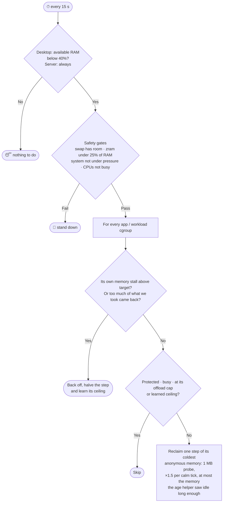

<div align="center">

# ⚡ Ultra RAM

### Frees RAM on Linux by moving memory nobody uses out of the way, without killing anything

**Desktops and servers · cgroup v2 + PSI feedback · one ~820 KB Rust binary**

[](https://www.rust-lang.org/)
[](https://docs.kernel.org/admin-guide/cgroup-v2.html)
[](https://systemd.io/)
[](#-quick-start)
[](https://azedev.com)
[](#-license)

*Created by **Yusif Ezizov** · **[Azedev](https://azedev.com)***

<a href="https://azedev.com"></a>

</div>

| | Wolfram | Senpai (Meta) | **Ultra RAM** |
|---|---:|---:|---:|
| 🖥️ Desktop: RAM gained | +495 MB | +613 MB | **+1262 MB** |
| 🖥️ Desktop: switch back to 5 apps | 15.1 s | 33.5 s | **5.0 s** |
| 🗄️ Server: RAM gained | +576 MB | — | **+942 MB** |
| 🗄️ Server: worst request p99.9 | 7.7 s | — | **30 ms** |

<sub>Same VM, same workload, fresh machine per run. Full tables and caveats in <a href="#-benchmark">Benchmark</a>.</sub>

---

## 📖 Contents

- [What it does](#-what-it-does)
- [Benchmark](#-benchmark) (desktop, server, game)
- [How it works](#-how-it-works)
- [Quick start](#-quick-start)
- [Requirements](#-requirements)
- [Commands](#-commands)
- [Configuration](#%EF%B8%8F-configuration)
- [Root extras](#-root-extras)
- [Server profile](#%EF%B8%8F-server-profile)
- [Safety](#%EF%B8%8F-safety)
- [Architecture](#%EF%B8%8F-architecture)
- [FAQ](#-faq)
- [Uninstall](#-uninstall)
- [License](#-license)

---

## 🤔 What it does

Apps hold a lot of memory they rarely touch: old tabs, loaded but unused libraries, caches, startup data. That memory blocks RAM that a new app or a build could use.

Ultra RAM finds that memory and moves it out, a little at a time, **before** RAM runs out:

- it never kills a process and never drops caches. A page an app touches again comes back on its own;
- it watches every app's own **memory stall** (PSI) and how much of what it moved comes back (**refaults**). As soon as an app notices, it backs off;
- it learns where each app's cold memory ends and stays below that point.

The idea comes from Meta's TMO / Senpai (memory offloading on its server fleet). Ultra RAM adds a desktop mode, a server mode for services, containers, VMs and pods, and optional root helpers that send the coldest memory to disk and pick only memory that has really gone unused.

| Common approach | What happens |
|---|---|
| `echo 3 > /proc/sys/vm/drop_caches` | Throws away the disk cache, which the kernel would free on demand anyway. Every app then re-reads its files: **slower**. |
| Killing "unneeded" processes | Lost tabs, state and unsaved work: **dangerous**. |
| Letting the kernel do it | The kernel reclaims only when memory is already short, exactly when you feel the stutter. |
| **Ultra RAM** | Moves cold memory early, in small steps, and stops the moment an app notices. |

---

## 🏁 Benchmark

All tools ran in the same VM (QEMU, Arch Linux kernel 7.2, 4 vCPU, 4 GB RAM, zram with zstd, zswap off) on the same synthetic workload, with a fresh machine per run. Ultra RAM used its optional root parts: a disk swap first (1.4 GB, throttled to 20k IOPS / 400 MB/s), then the lz4 zram tier, the age helper and prefetch. Where two numbers are shown, those are two runs.

Method, raw numbers and how to reproduce: [`bench/README.md`](bench/README.md).

### 🖥️ Desktop

Five background apps (3.4 GB) run for 15 minutes. Then a new 900 MB app opens, then you switch back to all five.

| Metric | Wolfram | Senpai (Meta) | No daemon | **Ultra RAM** |
|---|---:|---:|---:|---:|
| RAM gained | +495 / +491 MB | +613 MB | +3 MB | **+1262 / +1269 MB** |
| Memory the apps wanted back | 238 MB | 48 MB | 0 | **0 / 0 MB** |
| Switch back to all 5 apps | 15.1 / 15.4 s | 33.5 s | 0.1 s | **5.0 / 5.4 s** |
| Worst warm-memory access | 1827 / 2081 ms | 213 ms | 14 ms | **11 / 15 ms** |
| CPU of daemon + helpers | 56.5 / 54.6 s | 105.5 s | — | **23.3 / 23.6 s** |
| Daemon memory | 17.8 / 18.5 MB | — | — | **2.0 / 2.2 MB** |
| App memory stall (PSI) | 0 / 0 ms | 1728 ms | 0 | 5 / 0 ms |
| Worst hot-set sweep | 43 / 24 ms | 1868 ms | 38 ms | 62 / 25 ms |
| New 900 MB app load | 10.6 / 11.2 s | 11.1 s | 11.9 s | 10.9 / 12.0 s |

The last three rows are a tie: run-to-run spread is larger than the gap between tools, and running no daemon at all lands in the same range. The new-app load time is the CPU filling 900 MB; the same app takes 12–13 s to load with plenty of free RAM.

### 🗄️ Server

Four services (2.5 GB, the database protected by both tools) serve requests for 15 minutes. Then a 900 MB service is deployed, then a failover reads every service's cold data once.

| Metric | Wolfram | No daemon | **Ultra RAM** |
|---|---:|---:|---:|
| RAM gained | +576 MB | +2 MB | **+942 / +924 MB** |
| Memory the services wanted back | 238 MB | 0 | **107 / 107 MB** |
| Worst request p99 | 69.6 ms | 2.0 ms | **5.4 / 5.4 ms** |
| Worst request p99.9 | 7728 ms | 32 ms | **30 / 22 ms** |
| Worst request max | 8646 ms | 246 ms | **300 / 238 ms** |
| Failover: reading cold data back | 24.1 s | 0.07 s | **3.4 / 3.5 s** |
| CPU of daemon + helpers | 91 s | — | **62 s** |
| Daemon memory | 14.1 MB | — | **2.7 MB** |
| 900 MB deploy | 14.9 s | 15.0 s | 14.3 / 14.0 s |
| Worst request p99.9 during deploy | **95 ms** | 78 ms | 116 / 126 ms |
| Services' memory stall (PSI) | **0 ms** | 0 ms | 4.4 / 4.6 s |

Where Ultra RAM is behind: p99.9 during the deploy, and a small, steady memory stall (about 0.5% of the run) from reading rarely used data back from disk. Wolfram's PSI reads 0 even though its requests waited up to 8.6 s, so compare the latency rows between the two.

### 🎮 Game

The desktop setup again (five background apps, 4 GB RAM). After one minute a game starts: 1000 MB, four threads at 60 fps keeping the CPUs busy, and five minutes in it loads a 500 MB level. One run each.

| Metric | No daemon | Wolfram | Ultra RAM without game mode | **Ultra RAM** |
|---|---:|---:|---:|---:|
| Late frames (> 33 ms) | 1841 | 2467 | 340 | **90** |
| Frame time p99 | 33.2 ms | 35.9 ms | 23.3 ms | **17.8 ms** |
| Frame time p99.9 | 71.6 ms | 54.8 ms | 37.6 ms | **28.9 ms** |
| Worst frame | 6728 ms | 598 ms | 365 ms | **335 ms** |
| Level load (500 MB) | 40.5 s | 22.0 s | 7.5 s | **3.3 s** |
| Free RAM right before the level load | 43 MB | 181 MB | 229 MB | **450 MB** |
| Game's own major faults | 17065 | 514 | 0 | **0** |
| Switch back to the 5 apps afterwards | 27.8 s | 24.6 s | 7.1 s | **5.8 s** |

While a protected app (a game) is open, Ultra RAM keeps offloading the *background* apps even though the CPUs are busy, never touches the game, and runs at `SCHED_IDLE`, so it only gets CPU time the game leaves unused. Without a daemon the kernel swaps under pressure and takes the game's own memory too.

### Why the gap

- **Wolfram and Senpai keep what they move in compressed RAM.** That still costs about a third to half of the original. Ultra RAM sends the coldest pages to disk, where they cost no RAM and no compression CPU.
- **It picks memory that has really been idle.** The age helper sorts every app's memory by how long it has gone untouched, so almost nothing comes back. When it does, the daemon backs off.
- **The VM uses software emulation** (no KVM): absolute times are several times slower than on real hardware. Compare the columns with each other.

### On a real desktop

16 GB CachyOS desktop with Chrome, WhatsApp, Discord, Steam and terminals open, one `ultra-ram optimize --rounds 10` (about 30 s, rootless, zram only):

| | Before | After |
|---|---|---|
| Moved to zram | — | **573 MB**, 179 MB compressed |
| **Net RAM gained** | — | **≈ 394 MB** |
| Available RAM | 4.3 GB | 4.7 GB |
| Memory stall (PSI some10) | 0.00 | 0.00 |
| Apps closed | — | **0** |

> Ultra RAM makes memory use smarter, it does not create RAM. On a desktop the biggest wins still come from your browser's memory saver and not running several bundled-Chromium (Electron) apps at once. `ultra-ram analyze` shows where your memory goes.

---

## 🧠 How it works

### Where the memory goes

```
                 cold                     colder                    coldest
  ┌──────────┐  ───────►  ┌───────────┐  ───────►  ┌───────────┐
  │   RAM    │            │ zram (lz4)│            │ disk swap │      (root extras)
  │ hot data │  ◄───────  │ compressed│  ◄───────  │  no RAM   │
  └──────────┘  touched   └───────────┘  touched   └───────────┘
                again          │                      again
                               └─ untouched 30 min → recompressed with zstd
```

Without the root extras, cold memory goes to whatever swap you have, normally the distro's zram. With them, you choose the order: in the benchmark, disk first, then the lz4 tier.

### The control loop

Every 15 seconds:



The pieces that make it safe:

| Piece | What it does |
|---|---|
| **Per-app PSI** | Each app's own [memory stall time](https://docs.kernel.org/accounting/psi.html). If it rises, the app is backed off exponentially (2 → 4 → … 32 ticks). |
| **Refault window** | Compares what was taken from an app over the last ~2 minutes with what came back. Past `refault_tolerance_pct` the work was wasted: long pause (5 min, doubling). |
| **Learned ceiling** | Where an app first wanted memory back after a deep offload is where its cold part ends. Ultra RAM stays 2% below it from then on. |
| **Adaptive step** | Starts at 1 MB and grows ×1.5 while reclaim is free, so a fresh app is probed gently and a large cold app is handled quickly. |
| **Age map** *(root extra)* | Never asks for more than the memory the kernel's MGLRU saw idle for `cold_age_secs`. |

---

## 🚀 Quick start

```bash
git clone https://github.com/Really-y/ultra-ram.git
cd ultra-ram
```

| Setup | Command | Root |
|---|---|---|
| 🖥️ Desktop | `./install.sh` | no |
| 🖥️ Desktop + all extras (as benchmarked) | `./install.sh --with-root` | sudo for the extras |
| 🗄️ Server | `./install.sh --server` | yes |
| 🗄️ Server + all extras (as benchmarked) | `./install.sh --server --with-root` | yes |

The desktop installer:

1. checks cgroup v2, PSI and `memory.reclaim` access, and **installs nothing** if the system is not compatible;
2. builds the binary into `~/.local/bin/ultra-ram`;
3. writes `~/.config/ultra-ram/config`;
4. starts a **user** systemd service at login.

`--with-root` adds three system units: the [zram tier](#-zram-tier-lz4--zstd), [prefetch](#-prefetch-fast-switch-back) and the [age helper](#-age-helper-cold-memory-map). Each can be installed on its own with `--with-zram-tier`, `--with-prefetch` or `--with-age`.

> ⚠️ The root extras have so far been tested only in the benchmark VM. On your own machine, start with the rootless install and add the extras one by one.

---

## 📋 Requirements

| Requirement | Why | Check |
|---|---|---|
| Linux ≥ 5.19 (6.x recommended) | `memory.reclaim` | `uname -r` |
| cgroup v2 | per-app accounting and control | `stat -fc %T /sys/fs/cgroup` → `cgroup2fs` |
| PSI | the stall feedback | `cat /proc/pressure/memory` |
| systemd | user service (desktop) or system service (server) | `systemctl --user status` |
| Swap: zram and/or a disk swap | somewhere to put cold memory | `swapon --show` |
| Rust toolchain | build | `cargo --version` |
| *Age helper only:* MGLRU with page-table walks, debugfs | the age map | `cat /sys/kernel/mm/lru_gen/enabled` → `0x0007` |

Works out of the box on **CachyOS**, Arch, Fedora, openSUSE Tumbleweed and other modern systemd distros. KDE Plasma and GNOME put every app in its own cgroup, which is what Ultra RAM manages.

---

## 🧰 Commands

```text
ultra-ram analyze             Where RAM goes: apps, desktop session, services, kernel, zram, cache; leak suspects; diagnosis
ultra-ram watch               Live table, refreshed every 2 s
ultra-ram optimize            One safe optimization pass with before/after measurement (--dry-run, --rounds N)
ultra-ram status              What the daemon has done
ultra-ram pause | resume      Pause / resume automatic offloading
ultra-ram limit <app> <MB>    Soft memory limit: the overflow is swapped out, the app is never killed
ultra-ram unlimit <app>       Remove a limit
ultra-ram rollback            Undo everything: remove limits, pause automation

ultra-ram zram-tier ...       [root] lz4 zram tier with idle zstd recompression: setup | maintain | status | remove
ultra-ram prefetch ...        [root] bring an app back in, in parallel, when you return to it: run | once <app>
ultra-ram age ...             [root] age every app with MGLRU and publish the age map: run | status

ultra-ram status --profile server     [server] per workload: RAM, swap, reclaimed, PSI, refaults, state
ultra-ram status --json               [server] the same as JSON (/run/ultra-ram/status.json)
ultra-ram workloads                   [server] what it would manage, and what is protected (read-only)
```

> ℹ️ Desktop output is in **Azerbaijani** 🇦🇿, server output in English.

<details>
<summary><b>Example: <code>ultra-ram analyze</code></b></summary>

```text
═══ SİSTEM ═══
RAM 11.2G / 15.5G  boş (available) 4.3G (28%)  |  zram: 4.0G → 1.2G (x3.5, qənaət 2.8G)  |  PSI some 0.34/0.20/0.05
Təzyiq qiyməti: sağlam — proqramlar yaddaş gözləmir

═══ RAM HARA GEDİR ═══
  Tətbiqlər (app.slice)                    10.1G    65%
  Masaüstü sessiyası (plasma, kwin…)        790M     5%
  Kernel (slab, page tables)                750M     5%
  zram-ın tutduğu real RAM                  1.2G     7%

═══ TƏTBİQLƏR ═══
  TƏTBİQ                       RAM  ZRAM-DA    CƏMİ  NÜS.  MB/saat
  Chrome                      3.9G     693M    4.6G    11       +4
  zapzap                      2.5G     1.4G    3.9G     1       -2
  steam                       657M     621M    1.2G     1        0
```
</details>

<details>
<summary><b>Example: <code>ultra-ram optimize</code></b></summary>

```text
  TƏTBİQ                      KÖÇÜRÜLDÜ
  Chrome                           279M
  zapzap                           220M
  Alacritty                         62M
  CƏMİ                             704M

NƏTİCƏ: zram-a 573M köçdü, sıxılmış halda 179M tutur → xalis qazanc ≈ 394M
```
</details>

```bash
ultra-ram pause                    # before a demanding game session
ultra-ram resume                   # afterwards
ultra-ram limit chrome 4000        # keep each Chrome instance under ~4 GB
journalctl --user -u ultra-ram -f  # follow the daemon
```

---

## ⚙️ Configuration

Desktop: `~/.config/ultra-ram/config`. Server: `/etc/ultra-ram/config`. Both are reloaded every minute, no restart needed, and every value is clamped to a safe range.

| Key | Desktop | Server | Meaning |
|---|---|---|---|
| `activate_avail_pct` | `40` | `off` | Act only when available RAM is below this % |
| `max_busy_cpu_pct` | `60` | `off` | Wait while the CPUs are busier than this (an app launching, a build) |
| `active_cpu_pct` | `25` | `off` | An app using more than this % of a core is left alone |
| `psi_threshold_pct` | `0.5` | `1.5` | An app stalling on memory more than this % of the time is backed off |
| `refault_tolerance_pct` | `12.5` | `50` | Reclaim counts as wasted once this % of what was recently taken has come back |
| `max_offload_pct` | `50` | `50` | At most this share of an app may be swapped out |
| `step_pct` / `max_step_mb` | `4` / `64` | `4` / `64` | Per app and tick: at most this % of it, at most this many MB |
| `min_app_mb` | `100` | `100` | Smaller apps are ignored |
| `tick_secs` | `15` | `15` | Loop interval |
| `cold_age_secs` | `120` | `300` | With the age helper: take only memory idle at least this long (≤ 2 × the helper's interval) |
| `max_global_psi` | `10` | `10` | Stand down above this system-wide stall |
| `min_swap_free_pct` | `25` | `25` | Stand down when less swap than this is free |
| `max_zram_ram_pct` | `25` | `25` | Stand down when zram uses more RAM than this |
| `protect` | `gamescope, wine, lutris, heroic` | databases, `kubelet`, `containerd`, `dockerd`, `sshd`, … | Never touch apps whose name contains one of these |
| `notify` | `true` | `false` | Desktop notification for leak suspects |
| `leak_min_minutes` / `leak_min_slope_mb_h` / `leak_min_growth_mb` | `45` / `60` / `150` | same | When steady growth counts as a leak |

Server-only keys: `roots`, `discover_depth`, `respect_memory_low` (see [Server profile](#%EF%B8%8F-server-profile)).

The desktop benchmark used `activate_avail_pct = 55` and `max_offload_pct = 60`; the server benchmark `max_offload_pct = 60`.

---

## 🔧 Root extras

The daemon itself is rootless. These three helpers are optional system services. They make the biggest difference in the benchmark, and they were measured together, not one by one.

### 🧊 zram tier (lz4 + zstd)

Most distros ship one `zram0` with zstd: a good ratio, but every page that comes back is decompressed with zstd. The tier adds a **second** zram device:

| Stage | Algorithm | Why |
|---|---|---|
| Fresh offloads | **lz4** | Several times faster to compress and decompress: cheaper offloading, faster switch-back |
| Pages untouched for 30 min | recompressed with **zstd** | Memory nobody touches pays the slow path once and gets the better ratio |

- `setup` creates a new device via `hot_add` (your `zram0` and other swaps are not touched), gives it a swap priority above every existing swap, and turns zswap off while the tier exists (zswap in front of zram would compress twice).
- `maintain` marks long-idle pages and recompresses them (`--loop SECS` as a service).
- `remove` refuses unless RAM and free *disk* swap can take the contents back with 10% of RAM to spare. The unit removes the tier only on an explicit `systemctl stop`, not after a crash or at shutdown.

**Disk first, as in the benchmark:** give your disk swap the highest priority and put the tier below it. The coldest memory then goes to disk and costs no RAM:

```bash
sudo swapon --priority 300 /dev/<your-swap>              # or pri=300 in /etc/fstab
sudo ultra-ram zram-tier setup --priority 200 --no-recomp
```

```bash
sudo ultra-ram zram-tier setup      # --size 8G, --priority N, --no-recomp
ultra-ram zram-tier status          # device, algorithms, mm_stat, recompression
sudo ultra-ram zram-tier remove
```

Needs zram with lz4 and zstd. Recompression needs `CONFIG_ZRAM_MULTI_COMP` and age-based idle marking `CONFIG_ZRAM_TRACK_ENTRY_ACTIME` (both on in Arch and CachyOS kernels); without them the tier still works as a plain lz4 device.

### ⚡ prefetch (fast switch-back)

When you return to an app, it pulls its swapped memory back one page at a time, on its own thread. `prefetch` brings the rest back **in parallel** as soon as the app starts asking for it:

- every 500 ms it reads `memory.stat` of every app. An app "wakes" when it refaults at least `--trigger-pages` pages in one interval and takes major faults;
- it then calls `process_madvise(MADV_WILLNEED)` on the app's swapped regions from several threads, so the app's next access is a cheap minor fault;
- limits: never more than available RAM minus a floor (10% of RAM), never past an app's `memory.high`/`memory.max`, skipped under high system PSI, at most once a minute per app. It only reads memory back, never drops or reclaims anything.

```bash
sudo ultra-ram prefetch run --verbose      # the service loop
sudo ultra-ram prefetch once firefox       # wake one app now (testing, hotkey)
journalctl -u ultra-ram-prefetch -f
```

Needs Linux ≥ 5.15, x86_64 or arm64.

### 🧭 age helper (cold-memory map)

`memory.reclaim` takes pages from the oldest generation of the kernel's multi-gen LRU (MGLRU). But until the kernel has aged an app, that generation mixes hot and cold pages. The age helper fixes that:

- every `--interval-secs` (desktop 60, server 150) it asks the kernel to age every app (`/sys/kernel/debug/lru_gen`). Recently used pages move to the youngest generation; untouched ones sink. Nothing is evicted, aging only sorts;
- it writes `/run/ultra-ram-age/<app>`: per generation, how long it has been untouched and how much memory it holds (format at the top of `src/age.rs`);
- the daemon reads that map and never asks for more than the memory idle for `cold_age_secs`. Without the helper, or with a stale map, the daemon works as before.

```bash
sudo ultra-ram age run --verbose
sudo ultra-ram age status           # per app: generations, idle time, anon/file size
journalctl -u ultra-ram-age -f
```

Needs MGLRU with page-table walks (`0x0007`, default on Arch and CachyOS) and writable debugfs, which kernel lockdown (e.g. with Secure Boot) does not allow.

---

## 🗄️ Server profile

The same engine for systemd services, Docker / containerd / Podman containers, libvirt VMs and Kubernetes pods. It runs as a root system service, `ultra-ram-server.service`.

| | Desktop | Server |
|---|---|---|
| One "app" | a child of your `app.slice` | one workload: a service, a container, a VM, a pod (all of its containers together) |
| Where it looks | `user.slice/…/app.slice` | `roots`: `system.slice`, `machine.slice`, `kubepods.slice` / `kubepods`, `docker`, `system.slice/docker-*.scope`, `containerd`, down to `discover_depth` levels. Never `user.slice` or its own cgroup |
| When it acts | RAM getting short, CPUs not busy | always: free RAM on a server is room to pack more |
| Busy workload | skipped | not a reason to skip; its own PSI decides |
| Tuning | strict | a service rereads parts of its data every few minutes, so: stall target 1.5%, refault tolerance 50%, cold = idle ≥ 300 s, the step also grows under a light stall |
| Protected | games | `postgres, mysqld, mariadbd, redis, memcached, etcd, kubelet, containerd, dockerd, sshd, systemd-journald`, matched against the workload's name **and its processes' names**. Also every workload with `memory.min` or `memory.low` set (`respect_memory_low`) |
| Output | `ultra-ram status` | `/run/ultra-ram/status.json` every minute: per workload memory, swap, reclaimed, refaults, PSI, state (`reclaiming`, `backoff`, `capped`, `protected`, …) |

```bash
./install.sh --server               # /usr/local/bin/ultra-ram, /etc/ultra-ram/config, ultra-ram-server.service
./install.sh --server --with-root   # plus the zram tier, and prefetch + age on the same workloads

ultra-ram workloads                 # what it would manage, before it touches anything
ultra-ram status --profile server
journalctl -u ultra-ram-server -f
sudo ultra-ram pause --profile server
```

`ultra-ram print-default-config --profile server` prints the defaults with comments. The unit runs as root but with an **empty capability set**: the cgroup files of services and containers are owned by root, so file ownership is enough. The usual systemd hardening applies, except options that would hide the cgroup tree.

---

## 🛡️ Safety

The worst case is meant to be *"it did nothing"*.

| Guard | Default | Effect |
|---|---|---|
| Never kills, never drops caches | — | Only `memory.reclaim` (anonymous pages) and the opt-in `memory.high` of `limit` |
| Per-app stall back-off | PSI ≥ 0.5% (server 1.5%) | Exponential retreat; the step halves |
| Wasted-work back-off | refaults ≥ 12.5% (server 50%) | 5 min pause, doubling; the app's ceiling is learned |
| Offload cap | 50% of an app | Switching back stays quick |
| Swap room · zram size | ≥ 25% free · ≤ 25% of RAM | Stops before swap fills or zram crowds out RAM |
| Global stall | system PSI ≤ 10 | Never adds work to a struggling system |
| Busy CPUs | desktop: ≤ 60% | Waits while an app launches or a build runs. Not while a protected app (a game) is open: then the background apps are offloaded at `SCHED_IDLE` and the game is left alone |
| Suspend / resume | — | A long gap only re-baselines, no action |
| Protected | games / databases and system daemons | Never touched; configurable |
| Desktop shell | — | Only `app.slice`; Plasma, KWin, GNOME Shell are out of scope |
| Self-limits | `nice 19`, idle I/O, `MemoryMax=64M` | The daemon can't become the problem |
| `limit` floor | 256 MB | Refuses limits that would freeze an app |

---

## 🏗️ Architecture

```
┌──────────────────────────────────────────────────────────────────────┐
│                           ultra-ram daemon                           │
│  ┌─────────────┐   ┌──────────────┐   ┌───────────────────────────┐  │
│  │   Sampler   │──►│ Safety gates │──►│      Reclaim engine       │  │
│  │ cgroup stats│   │ RAM/swap/PSI │   │ per-app PSI + refaults,   │  │
│  └─────────────┘   │ CPU          │   │ adaptive step, ceilings   │  │
│         │          └──────────────┘   └─────────────┬─────────────┘  │
│         ▼                                           ▼                │
│  ┌─────────────┐   ┌──────────────┐     memory.reclaim (anon only)   │
│  │ Leak trend  │──►│ notify-send  │     memory.high (opt-in limit)   │
│  └─────────────┘   └──────────────┘                                  │
└───────────────────────────────▲──────────────────────────────────────┘
                                │ /run/ultra-ram-age/<app>
   root extras (optional) ──────┴─────────────────────────────────────
   age:       /sys/kernel/debug/lru_gen  → sorts memory by idle time
   zram-tier: lz4 zram device, zstd recompression of idle pages
   prefetch:  process_madvise(MADV_WILLNEED) when an app comes back
```

| | |
|---|---|
| Language | Rust, standard library only, no crates |
| Binary | ~820 KB (`opt-level = "s"`, LTO, stripped) |
| Kernel interfaces | cgroup v2 `memory.reclaim`, `memory.high`, `memory.pressure`, `memory.stat`, `memory.swap.current`, `cpu.stat`; `/proc/pressure/memory`; zram `mm_stat`; MGLRU `lru_gen`; `process_madvise` |
| Reclaim mode | `swappiness=max` (anonymous only), with a fallback for older kernels |
| State | `$XDG_RUNTIME_DIR/ultra-ram/` (desktop), `/run/ultra-ram/` (server): RAM-backed, cleared at reboot |
| Service | desktop: **user** unit in `background.slice`, `Nice=19`, idle I/O, `MemoryMax=64M`; server: system unit with no capabilities |

---

## ❓ FAQ

<details>
<summary><b>Isn't this just swapping? Swapping is slow.</b></summary>

Swapping is slow when the kernel swaps out memory that is still in use, under pressure, all at once. Ultra RAM moves only memory that has gone unused, early and in small steps, and stops when an app starts wanting it back. That is why in the benchmark the apps wanted back 0 MB on the desktop, and why switching back was 3× faster than with Wolfram, which keeps everything in zram.
</details>

<details>
<summary><b>Do I need the root extras?</b></summary>

No. The rootless daemon works with any swap you already have. The extras, especially a disk swap in front of zram plus the age helper, are what took the desktop benchmark from about +500–700 MB (rootless) to +1260 MB.
</details>

<details>
<summary><b>Why only anonymous memory, not page cache?</b></summary>

Page cache already counts as available and is dropped instantly when needed. Evicting it frees nothing useful and forces disk re-reads.
</details>

<details>
<summary><b>Will it slow down my games?</b></summary>

No: the game is protected and never touched. While it runs, Ultra RAM offloads only the background apps (browser, chat), at `SCHED_IDLE`, so the game gets their RAM. In the benchmark that cut late frames from 1841 to 90 and a level load from 40 s to 3.3 s. `ultra-ram pause` still stops it at any time.
</details>

<details>
<summary><b>Can it lose data?</b></summary>

No. It never kills processes and never discards memory. Pages are only moved to swap and come back when touched.
</details>

<details>
<summary><b>Does it replace earlyoom / systemd-oomd?</b></summary>

No, they work together. Ultra RAM keeps memory from filling up needlessly; an OOM daemon is the last line of defence if it fills anyway. `ultra-ram analyze` tells you if you are missing one.
</details>

---

## ⏪ Uninstall

```bash
ultra-ram rollback            # remove all limits, pause automation (stays installed)
./install.sh --uninstall      # remove everything, including the server profile and root extras; keeps your config
rm -r ~/.config/ultra-ram     # remove the config too
```

Memory already in swap flows back to RAM as apps use it. Nothing to restore by hand. If the zram tier can't be removed yet (not enough free RAM), the uninstaller stops with an error and keeps everything.

---

## 📜 License

Ultra RAM is free software under the **[GNU Affero General Public License v3.0](LICENSE)** (AGPL-3.0-only).

- ✅ Use it, study it, change it and share it, for free, on your desktop or your servers.
- 🔁 If you distribute a changed version, **or run a changed version as a service others use over a network**, you must publish your changes under the same license.

**Commercial license:** if you want to build Ultra RAM into a closed-source product or service, or use a modified version without publishing your changes, a commercial license is available from **[Azedev](https://azedev.com)**.

<a href="https://azedev.com"></a>

---

<div align="center">

**Ultra RAM** is created and maintained by

### Yusif Ezizov
**Azedev**

Inspired by Meta's TMO / Senpai research on transparent memory offloading.

💼 Need something like this for your servers or product?

<a href="https://azedev.com"></a>

⭐ If Ultra RAM made your machine smoother, consider starring the repo.

<sub>Released under the <a href="LICENSE">GNU AGPL v3.0</a> · © 2026 Yusif Ezizov · Azedev</sub>

</div>
